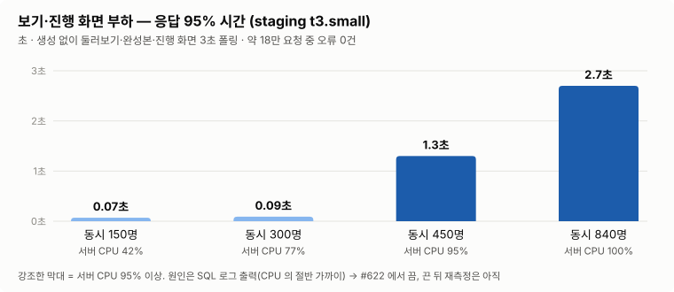
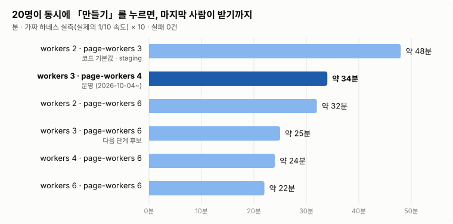
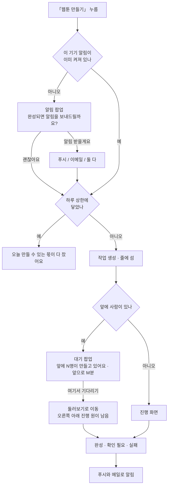
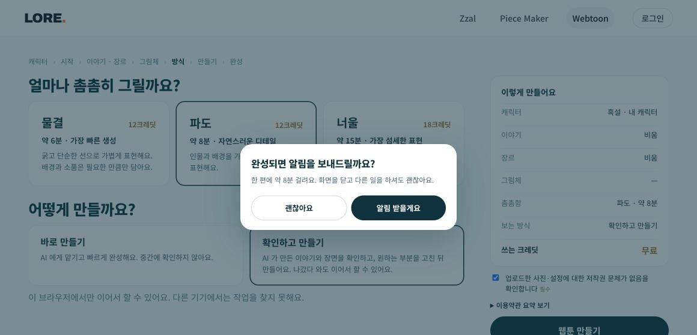
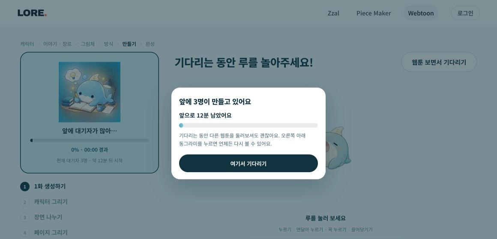

# 운영 용량 — 부하 시험, 동시 작업 수, 밀렸을 때 사용자에게 보이는 것

사용자가 몰리면 어디서 먼저 막히는지, 그래서 동시 작업 수와 돈 상한을 어떻게 정했는지 적은 문서입니다.
설정 값을 바꾸기 전, 광고로 사용자를 받기 전, 「서버가 버틸까」를 판단해야 할 때 읽습니다.
시험은 2026-10-04 에 했고 운영 값도 같은 날 정했습니다(#646).

## 한눈에

| | 지금 | 근거 |
|---|---|---|
| 보기·진행 화면 | staging(t3.small)에서 동시 약 300명까지 응답 0.1초 안. 450명부터 CPU 100% 로 느려짐(오류는 0) | [1단계](#1단계--보기진행-화면-부하) |
| 생성 줄 | 운영 workers 3 · page-workers 4. 20명이 동시에 누르면 마지막 사람이 약 34분 기다림 | [2단계](#2단계--생성-줄) |
| 먼저 막히는 것 | 서버 CPU·메모리보다 **돈 상한**(하루 13,000원 ≈ 8편)과 **그림 동시 작업 수**(page-workers) | [돈 상한](#돈-상한) |
| 밀렸을 때 | 만들기 직전 알림 팝업, 진행 화면 대기 팝업(앞에 N명 · M분), 완성·실패 푸시와 메일 | [밀렸을 때 사용자에게 보이는 것](#밀렸을-때-사용자에게-보이는-것) |
| 오류가 났을 때 | 안전 기준(선정성) 실패는 이유와 고칠 점을 보여 줌. 서버 장애 대응 절차는 **아직 정하지 않음** | [오류가 났을 때](#오류가-났을-때) |

## 지금 설정

| 이름 | 뜻 | 코드 기본값 | 운영 | staging |
|---|---|---|---|---|
| `lore.webtoon.workers` | 만들기 작업을 몇 편 나란히 돌리나 | 2 | **3** | 2 |
| `lore.webtoon.page-workers` | 장 그림을 서버 전체에서 몇 장 동시에 그리나 | 3 | **4** | 3 |
| `lore.webtoon.spend.daily-krw` | 하루 지출 상한(원) | 40,000 | **13,000** | 40,000 |
| `lore.webtoon.spend.daily-runs` | 하루 편수 상한 | 30 | 30 | 30 |

- 코드 기본값: `JobRunner.java:215-216`, `SpendGuard.java:38-39`.
- 운영 값은 Parameter Store `/lore/prod/lore_webtoon_workers` · `lore_webtoon_page_workers` ·
  `lore_webtoon_spend_daily_krw` 에 넣었습니다. 서버가 뜰 때 읽으므로 그다음 운영 배포(2026-10-04 11:17, #635)부터
  적용됩니다. Parameter Store 값은 다시 읽어 확인했고, 운영 서버 시작 로그로는 아직 확인하지 않았습니다.
- staging 은 서버가 t3.small(메모리 2GB)이라 올리지 않았습니다. 아래 [메모리](#왜-workers-3--page-workers-4-인가)를 보면
  지금 값만으로도 최악의 경우 여유에 거의 닿습니다.
- OpenAI 쪽: 사용 등급 tier 4(그림 분당 150장), 월 지출 한도 $350.

## 1단계 — 보기·진행 화면 부하

**무엇을 쟀나.** 생성은 하지 않고 둘러보기 · 완성본 · 그림 · 진행 화면 폴링만 보냈습니다. 진행 화면은 3초마다
상태를 묻고(`Progress.tsx:36` `POLL_MS`) 그때마다 DB 를 읽기 때문에, staging DB 에 「만드는 중」 작업을 넣어 두고
가상 사용자가 3초마다 묻게 했습니다. 도구는 k6, 대상은 staging(운영과 같은 CloudFront · EC2 · RDS 구성, 서버만
t3.small 로 운영 t3.medium 보다 작음)입니다.



| 동시 인원 | 초당 요청 | 응답 95% | 서버 CPU |
|---|---|---|---|
| 150명 | 130 | 0.07초 | 42% |
| 300명 | 260 | 0.09초 | 77% |
| 450명 | 310 | 1.3초 | 95% |
| 840명 | 380 | 2.7초 | 100% |

- 두 번 합쳐 약 18만 요청 중 오류는 0건이었습니다. DB 는 CPU 최대 34% 로 여유가 있었습니다.
- **서버 CPU 의 절반 가까이가 SQL 로그를 찍는 데 쓰였습니다.** 공용 설정에 `show-sql: true` · `format_sql: true`
  가 켜져 있어 쿼리마다 여러 줄이 찍혔고(1분에 약 10만 줄), `journald`(56%)와 `rsyslogd`(49%)가 java(70%)만큼
  CPU 를 썼습니다. #622 에서 기본을 끔으로 바꿨습니다(로컬에서 보고 싶으면 `.env` 에 `JPA_SHOW_SQL=true`).
  **끈 뒤에 같은 시험을 다시 재지는 않았습니다** — 한계가 오를 것으로 보지만 숫자는 아직 없습니다.
- 운영은 서버가 한 단계 크므로 이 표보다 여유가 있습니다.

## 2단계 — 생성 줄

**무엇을 쟀나.** 「N명이 동시에 만들기를 누르면 마지막 사람이 몇 분 기다리나」입니다. OpenAI 를 부르지 않으려고
서버의 파이썬 실행 파일 자리에 가짜 하네스(`webtoon/tools/loadtest/fakepy`)를 끼웠습니다. 가짜 하네스는 이미 만든
작품의 결과 파일을 걸음별로 복사하고, 걸음마다 실제 걸린 시간의 1/10 만큼 기다립니다. 줄 서기 · 동시 작업 ·
DB 기록 · 이어 붙이기 · 올리기는 진짜로 돕니다. 로컬에서 배포와 같은 jar · 같은 힙(-Xmx768m)으로 띄웠고,
workers 2·3·4·6 × page-workers 3·4·6 × 동시 2·5·10·20명, 48개 조합을 모두 돌렸습니다. **실패는 0건**입니다.



그래프는 실측값에 10을 곱한 것입니다. 실제 단계 시간으로 줄 세우기를 따라 계산하는 시뮬레이터(`sim.py`)의 값과
맞춰 봤고(지금 설정 20명: 실측 285.6초 × 10 ≈ 48분, 시뮬레이터 44.7분), 운영 설정의 동시 인원별 값은 시뮬레이터로
뽑았습니다.

| 동시에 누른 사람 | 지금 운영 (w3 · p4) | 코드 기본값 (w2 · p3) | 다음 후보 (w3 · p6) |
|---|---|---|---|
| 5명 | 약 9분 | 약 12분 | 약 7분 |
| 10명 | 약 17분 | 약 23분 | 약 12분 |
| 20명 | 약 33분 | 약 45분 | 약 24분 |
| 30명 | 약 49분 | 약 66분 | 약 36분 |
| 시간당 처리 | 약 37편 | 약 27편 | 약 51편 |

마지막 사람 기준이고, 혼자 만들면 한 편에 약 4분입니다(파도 화질). 사람이 확인하는 자리(이야기 고르기 · 시트 확인)
에서 바로 누른다고 가정했습니다.

**알게 된 것**

- **속도는 page-workers(동시에 그리는 그림 수)가 정합니다.** workers 만 2 → 6 으로 올리면 48분이 41분으로 줄어드는 데
  그칩니다. 그림 걸음이 서버 전체가 나눠 쓰는 page-workers 자리를 기다리기 때문입니다.
- **서버 자원은 병목이 아니었습니다.** 어느 조합에서도 JVM 메모리는 630MB 이하, java CPU 는 평균 0.1코어였습니다.
  그림 프로세스는 대부분 OpenAI 응답을 기다리는 시간입니다. 진행 화면 폴링 응답 95% 는 9~22ms 였습니다.
- 시험 도구는 진행 화면을 0.8초마다 물었습니다(그때 화면 값). 지금 화면은 3초라 실제 부하는 이보다 작습니다.

<details>
<summary>48개 조합 실측 원본 (가짜 하네스 시간, 실제의 1/10)</summary>

| 설정 | N | 완료/실패 | 줄 대기 중앙/최대(s) | 전체 중앙/최대(s) | 편/분 | JVM RSS 최대(MB) | java CPU 평균(코어) | 폴링 p95(ms) |
|---|---|---|---|---|---|---|---|---|
| w2 p3 | 2 | 2/0 | 0.9/0.9 | 28.7/36.8 | 3.3 | 576 | 0.1 | 15.1 |
| w2 p3 | 5 | 5/0 | 17.1/41.6 | 49.8/70.9 | 4.2 | 604 | 0.1 | 12.3 |
| w2 p3 | 10 | 10/0 | 56.9/113.0 | 87.9/144.7 | 4.2 | 621 | 0.1 | 11.3 |
| w2 p3 | 20 | 20/0 | 154.3/253.1 | 186.0/285.6 | 4.2 | 627 | 0.1 | 10.7 |
| w2 p4 | 2 | 2/0 | 0.9/0.9 | 25.4/30.3 | 4.0 | 578 | 0.1 | 15.4 |
| w2 p4 | 5 | 5/0 | 14.7/34.2 | 42.4/58.6 | 5.1 | 596 | 0.1 | 13.4 |
| w2 p4 | 10 | 10/0 | 49.6/89.4 | 73.2/114.6 | 5.2 | 617 | 0.1 | 12.6 |
| w2 p4 | 20 | 20/0 | 125.9/201.3 | 151.1/225.7 | 5.3 | 624 | 0.1 | 12.5 |
| w2 p6 | 2 | 2/0 | 0.0/0.0 | 22.2/26.3 | 4.6 | 579 | 0.1 | 16.0 |
| w2 p6 | 5 | 5/0 | 13.0/30.2 | 38.3/50.5 | 5.9 | 607 | 0.1 | 11.1 |
| w2 p6 | 10 | 10/0 | 47.3/77.2 | 69.3/99.2 | 6.0 | 623 | 0.1 | 12.7 |
| w2 p6 | 20 | 20/0 | 111.2/167.1 | 132.3/189.1 | 6.3 | 630 | 0.1 | 10.9 |
| w3 p3 | 2 | 2/0 | 0.0/0.0 | 28.8/36.9 | 3.2 | 585 | 0.1 | 15.1 |
| w3 p3 | 5 | 5/0 | 1.6/27.7 | 46.5/70.1 | 4.3 | 607 | 0.1 | 11.9 |
| w3 p3 | 10 | 10/0 | 41.5/89.4 | 76.5/131.7 | 4.6 | 618 | 0.1 | 11.2 |
| w3 p3 | 20 | 20/0 | 121.7/221.4 | 163.1/262.8 | 4.6 | 630 | 0.1 | 9.0 |
| w3 p4 | 2 | 2/0 | 0.0/0.0 | 25.5/30.4 | 4.0 | 584 | 0.1 | 16.4 |
| w3 p4 | 5 | 5/0 | 1.7/21.2 | 38.4/54.7 | 5.5 | 602 | 0.1 | 13.9 |
| w3 p4 | 10 | 10/0 | 28.5/69.9 | 61.0/103.3 | 5.8 | 624 | 0.1 | 13.0 |
| w3 p4 | 20 | 20/0 | 96.8/171.4 | 130.1/204.7 | 5.9 | 632 | 0.1 | 14.8 |
| w3 p6 | 2 | 2/0 | 0.9/0.9 | 22.2/26.3 | 4.6 | 582 | 0.1 | 17.2 |
| w3 p6 | 5 | 5/0 | 1.6/19.6 | 30.2/43.2 | 7.0 | 600 | 0.1 | 13.9 |
| w3 p6 | 10 | 10/0 | 28.5/55.3 | 52.9/80.5 | 7.5 | 621 | 0.1 | 13.8 |
| w3 p6 | 20 | 20/0 | 78.8/125.9 | 100.8/150.2 | 8.0 | 628 | 0.1 | 13.5 |
| w4 p3 | 2 | 2/0 | 0.9/0.9 | 29.5/36.8 | 3.3 | 578 | 0.1 | 18.7 |
| w4 p3 | 5 | 5/0 | 0.8/20.4 | 46.5/70.1 | 4.3 | 600 | 0.1 | 12.6 |
| w4 p3 | 10 | 10/0 | 28.5/77.1 | 75.6/130.0 | 4.6 | 620 | 0.1 | 11.9 |
| w4 p3 | 20 | 20/0 | 105.7/202.9 | 157.7/257.4 | 4.7 | 628 | 0.1 | 12.9 |
| w4 p4 | 2 | 2/0 | 0.0/0.0 | 25.4/30.3 | 4.0 | 584 | 0.1 | 16.7 |
| w4 p4 | 5 | 5/0 | 0.0/17.1 | 38.3/54.6 | 5.5 | 602 | 0.1 | 12.0 |
| w4 p4 | 10 | 10/0 | 14.7/56.1 | 55.4/97.6 | 6.2 | 619 | 0.1 | 14.3 |
| w4 p4 | 20 | 20/0 | 81.2/155.9 | 122.6/197.3 | 6.1 | 625 | 0.1 | 12.2 |
| w4 p6 | 2 | 2/0 | 0.9/0.9 | 22.1/26.2 | 4.6 | 575 | 0.1 | 17.5 |
| w4 p6 | 5 | 5/0 | 0.8/16.3 | 30.2/42.4 | 7.1 | 598 | 0.1 | 14.5 |
| w4 p6 | 10 | 10/0 | 13.8/41.4 | 44.8/73.2 | 8.2 | 618 | 0.1 | 13.5 |
| w4 p6 | 20 | 20/0 | 63.4/111.9 | 93.4/142.9 | 8.4 | 625 | 0.1 | 13.4 |
| w6 p3 | 2 | 2/0 | 0.9/0.9 | 28.7/36.8 | 3.3 | 576 | 0.1 | 16.8 |
| w6 p3 | 5 | 5/0 | 0.8/0.8 | 46.5/70.1 | 4.3 | 600 | 0.1 | 12.7 |
| w6 p3 | 10 | 10/0 | 0.8/49.7 | 70.0/125.2 | 4.8 | 619 | 0.1 | 12.7 |
| w6 p3 | 20 | 20/0 | 70.7/168.8 | 145.4/244.3 | 4.9 | 626 | 0.1 | 11.0 |
| w6 p4 | 2 | 2/0 | 0.0/0.0 | 25.4/30.3 | 4.0 | 583 | 0.1 | 17.1 |
| w6 p4 | 5 | 5/0 | 0.0/0.0 | 38.4/54.7 | 5.5 | 600 | 0.1 | 11.8 |
| w6 p4 | 10 | 10/0 | 0.8/36.7 | 54.6/96.8 | 6.2 | 623 | 0.1 | 12.3 |
| w6 p4 | 20 | 20/0 | 55.2/129.9 | 112.9/187.5 | 6.4 | 631 | 0.1 | 10.9 |
| w6 p6 | 2 | 2/0 | 0.0/0.0 | 22.2/26.3 | 4.6 | 579 | 0.1 | 22.2 |
| w6 p6 | 5 | 5/0 | 0.0/0.0 | 33.5/42.4 | 7.1 | 599 | 0.1 | 11.8 |
| w6 p6 | 10 | 10/0 | 0.8/28.5 | 40.4/68.0 | 8.8 | 622 | 0.1 | 12.5 |
| w6 p6 | 20 | 20/0 | 43.0/91.7 | 83.6/133.1 | 9.0 | 628 | 0.1 | 12.3 |

</details>

## 왜 workers 3 · page-workers 4 인가

CPU 는 문제가 아니었으므로 **메모리**가 상한을 정합니다. 장 그림 하나마다 파이썬 프로세스가 하나 뜹니다. 모델
호출 없이 재 보니 하나에 약 118MB 였고, 받은 그림을 처리하는 몫을 더해 장당 150~200MB 로 잡았습니다(이 값은
추정입니다). 운영 서버(t3.medium, 4GB)의 여유는 약 2.6GB, 서버 힙이 최대까지 커지는 몫을 빼면 파이썬에 쓸 수
있는 몫은 약 1.9GB 입니다(스왑 2GB 는 따로).

| 설정 | 파이썬 최대 메모리(추정) | 운영 여유 1.9GB 대비 |
|---|---|---|
| workers 2 · page-workers 3 | 약 0.9GB | 넉넉함 |
| **workers 3 · page-workers 4** | 약 1.25GB | 괜찮음 |
| workers 3 · page-workers 6 | 약 1.65GB | 괜찮지만 여유가 적음 (넘치면 스왑이 받음) |
| workers 4 · page-workers 6 | 약 1.8GB | 빠듯함 |

그래서 한 번에 올리지 않고 단계로 갑니다.

1. **지금: workers 3 · page-workers 4.** 20명 기준 마지막 사람 대기가 약 48분에서 약 34분으로 줄어듭니다.
2. 며칠 동안 운영 메모리 · 스왑과 OpenAI 429 오류를 봅니다.
3. 문제가 없으면 **page-workers 6** 으로 올립니다(약 25분). OpenAI 한도는 page-workers 6 이어도 분당 많아야 약
   24장이라 tier 4(분당 150장) 안입니다.

## 돈 상한

한 편에 OpenAI 값이 약 $1.2(약 1,650원) 듭니다(2026-10-04, 로컬 12편 · dev 4편 평균, 가장 비싼 편 $1.80).

| | 값 | 뜻 |
|---|---|---|
| 서버 하루 상한 | 13,000원 | 하루 약 8편. 월 약 $300 |
| OpenAI 월 한도 | $350 | 비상 차단용. dev · staging 에서 만든 것도 같이 잡힘 |

- 실제로 막는 것은 서버 하루 상한입니다. OpenAI 월 한도가 먼저 닿으면 그달 남은 기간은 모든 생성이 중간에
  실패하므로, 월 한도를 서버 상한보다 조금 넉넉하게 둡니다.
- 하루 상한에 닿으면 만들기를 누를 때 「오늘 만들 수 있는 몫이 다 찼어요 — 내일 다시 와 주세요.」가 뜹니다
  (`SpendGuard.java:93,100`). 지금 도는 작업이 쓸 돈까지 미리 세어서 막습니다(`JobQueue`).
- 사용자가 늘면 한 달 예산을 먼저 정하고, OpenAI 월 한도 = 예산 + 여유, 서버 하루 상한 = 예산 ÷ 30 으로 맞춥니다.

| 한 달 예산 | 한 달에 만들 수 있는 양 | OpenAI 월 한도 | 서버 하루 상한 |
|---|---|---|---|
| $300 (지금) | 약 250편 (하루 8편) | $350 | 약 13,000원 |
| $500 | 약 420편 (하루 14편) | $550 | 약 23,000원 |
| $900 | 약 750편 (하루 24편) | $950 | 40,000원 |

## 밀렸을 때 사용자에게 보이는 것



**1. 만들기 직전 알림 팝업** (`webtoon/fe/ui/NotifyAsk.tsx`, #641)



- 「웹툰 만들기」를 누르면 먼저 뜹니다. 「알림 받을게요」를 누르면 푸시 / 이메일 / 둘 다를 고릅니다.
- 푸시는 브라우저 허용을 요청합니다. 막혀 있으면 주소창에서 바꾸는 법을, 아이폰은 홈 화면에 추가하는 법을
  안내합니다. 이메일은 로그인한 사람은 계정 메일로 가고, 게스트는 주소를 적습니다.
- 무엇을 골라도 생성은 시작합니다. 바깥을 누르거나 Esc 는 시작하지 않고 닫습니다.
- 이 기기 알림이 이미 켜져 있으면 뜨지 않습니다.

**2. 대기 팝업** (`webtoon/fe/ui/QueueDialog.tsx`, #641)



- 앞에 사람이 있으면 진행 화면에서 작업마다 처음 한 번 뜹니다. 「앞에 N명이 만들고 있어요 · 앞으로 M분 남았어요」와
  차오르는 게이지를 보여 줍니다.
- 「여기서 기다리기」를 누르면 둘러보기로 갑니다. 오른쪽 아래 진행 원이 남고, 기다리는 동안 그 원을 누르면 이
  팝업이 다시 뜹니다. 진행 화면 왼쪽 카드에도 「현재 대기자 N명 · 약 M분 뒤 시작」이 보입니다.
- 게이지는 서버가 시작했다고 할 때까지 97% 에서 멈춥니다. 다 찼는데 시작하지 않으면 거짓말이 되기 때문입니다.

**앞에 몇 명, 몇 분은 어떻게 세나** (`webtoon/be/.../job/JobQueue.java`)

- DB `webtoon_job` 에서 `QUEUED`(아직 안 시작)와 `RUNNING`(도는 중)만 셉니다. 이야기 고르기 · 시트 확인처럼
  사람을 기다리는 작업은 일꾼을 잡고 있지 않아서 세지 않습니다. 그 사람이 돌아오면 내 앞에 다시 설 수 있어서,
  예상은 실제보다 **짧게** 나올 수 있습니다.
- 줄 순서는 만든 순서가 아니라 줄에 선 순서입니다. 이야기를 고르거나 시트를 확인한 작업은 그때 줄 끝에 다시 섭니다.
- 분은 올림합니다. 30초를 「0분」이라고 적으면 바로 시작하는 줄 알기 때문입니다.
- 화면에 적어 준 앞 인원(`queued_ahead`)과 실제로 기다린 시간(`started_at − created_at`)이 같은 표에 남으므로,
  사용자를 받은 뒤 예상이 맞았는지 맞춰 볼 수 있습니다.

**3. 끝나면 오는 알림** (`webtoon/be/.../push/`)

- 푸시는 완성 · 확인 필요(캐릭터 다시 그리기 등) · 실패(환급 안내 포함) 세 가지입니다. 메일도 같은 경우에 갑니다.
- 푸시 키(`LORE_WEBTOON_PUSH_PUBLIC_KEY` · `LORE_WEBTOON_PUSH_PRIVATE_KEY`)가 없으면 푸시만 조용히 꺼지고 화면도
  알림 받기를 띄우지 않습니다(`PushSender`).

## 오류가 났을 때

### 안전 기준(선정성) — 정리돼 있음

자세한 것은 [safety.md](safety.md) 「걸렸을 때 사용자에게 보이는 것」에 있습니다(#626). 원칙은 「그냥 실패」로
끝내지 않고 무엇이 걸렸고 무엇을 바꾸면 되는지 말하는 것입니다. 같은 내용으로 다시 누르면 또 걸리기 때문입니다.

| 어디서 걸렸나 | 어떻게 되나 | 크레딧 |
|---|---|---|
| 입력 글 | 만들기 전에 막고 「이 내용으로는 만들 수 없어요 …」. 한국어는 moderation 이 잘 못 잡아 금지어 한 겹을 덧댐 | 안 받음 |
| 캐릭터 시트 그림 | 실패하지 않고 멈춤. 사진이나 옷차림 설명을 바꿔 캐릭터만 다시 그림(작업당 3번) | 더 안 받음, 그만두면 환급 |
| 장면 그림 1~2장 | 그 장만 빈 장으로 두고 완성. 편집실에서 장면 설명을 고쳐 다시 그림 | 그대로, 빈 장 다시 그리기는 무료 |
| 장면 그림 3장 이상 | 이유와 함께 실패 | 환급 |
| 편집실 다시 그리기 | 이유와 고칠 점을 보여 주고 원래 그림은 그대로 | 실패하면 환급 |
| 글 모델 거절 | 「AI가 만들 수 없다고 판단한 부분이 있어요 …」 | 환급 |

### 서버 오류 — 대응 절차는 아직 정하지 않음

누가 무엇을 보고 어떤 순서로 복구하는지는 아직 정하지 않았습니다. 지금 있는 장치만 적습니다.

| 장치 | 하는 일 | 위치 |
|---|---|---|
| 배포 헬스체크 | 배포 뒤 `/actuator/health` 가 통과할 때까지 기다림 | `infra/dev/deploy-dev.sh`, `infra/staging/deploy-api.sh` |
| 배포 실패 시 되돌리기 | staging 은 헬스체크 실패면 이전 jar 로 되돌림 | `infra/staging/deploy-api.sh:96` |
| 배포 실패 알림 | 텔레그램으로 알림(시크릿이 없으면 건너뜀) | `.github/workflows/deploy.yml` `notify_failure` |
| 배포 실패 대응 순서 | 로컬 빌드 → 서버 빌드 로그 → 최신 run 하나만 재실행 | [rules/deploy-failure.md](rules/deploy-failure.md) |
| 멈춘 작업 정리 | 서버가 죽으면 돌던 작업은 이어받을 수 없음. 다시 뜰 때 남은 `RUNNING` 작업을 실패로 돌리고 환급 | `StaleJobs` |
| 파이썬 시간 제한 | 하네스 프로세스 하나가 1시간을 넘기면 끊음 | `HarnessProcess` (`lore.webtoon.python.timeout-seconds`, 기본 3600) |
| 실패 이유 기록 | 하네스가 `failure.json` 에 이유를 남기고 서버가 사용자 문구로 바꿈 | [safety.md](safety.md) 「코드가 이유를 아는 길」 |

없는 것: 서버가 죽었을 때 알림(지금 알림은 「배포 실패」뿐), CloudWatch 알람, 운영 서버 재시작 · DB 복구 절차.
운영은 EC2 1대 · RDS 1대(단일 AZ)라 둘 중 하나가 멈추면 서비스 전체가 멈춥니다([server.md](server.md) 2절).

## 사용자가 늘면 할 일

[#617](https://github.com/SW-Maestro-TRY/Lore/issues/617) 에 모아 두었습니다. DB 저장소 자동 확장 켜기, DB 를
db.t4g.small 로 올리기(진행 화면 폴링이 DB 를 읽으므로 동시에 기다리는 사람이 늘면 먼저 버거워짐), journald 로그
상한. 그리고 위 단계대로 page-workers 6 으로 올리기와, SQL 로그를 끈 뒤 1단계를 다시 재기가 남아 있습니다.

## 다시 재려면

생성 줄 시험 도구는 `webtoon/tools/loadtest/` 에 있습니다. OpenAI 를 부르지 않습니다 — 가짜 하네스가 모델 열쇠를
환경에서 지우고 소켓 연결을 막습니다.

```
./gradlew bootJar                                    # 저장소 루트에서
cd webtoon/tools/loadtest
python3 matrix.py --workers 2,3,4,6 --page-workers 3,4,6 --n 2,5,10,20
python3 table.py                                     # 결과 표
python3 sim.py                                       # 실제 단계 시간으로 계산
```

- `matrix.py` 는 조합마다 로컬 DB `lore` 의 사본을 새로 만들고(알림 주소 · 푸시 구독은 비움) 끝나면 지웁니다.
  공유 DB 로 서버를 하나 더 띄우면 남의 작업이 실패 처리되므로 사본으로만 돌립니다.
- 가짜 하네스는 템플릿 작품(`template/`, gitignore) 하나를 복사합니다. 처음 돌릴 때 로컬에서 끝까지 만든 작품
  폴더 하나를 넣어 둡니다.
- 시험이 끝나도 로컬 그림 창고에 시험용 그림이 남습니다(2026-10-04 에는 약 11,000개 · 10.7GB). 지우기 전에 DB 에
  없는 파일인지 확인합니다.
- 1단계(보기·진행 화면) k6 스크립트는 남아 있지 않습니다. 다시 재려면 새로 씁니다.
