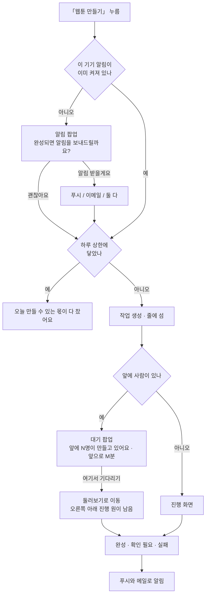

# 운영 용량 — 부하 시험, 동시 작업 수, 밀렸을 때 사용자에게 보이는 것

사용자가 몰리면 어디서 먼저 막히는지, 그래서 동시 작업 수와 돈 상한을 어떻게 정했는지 적은 문서입니다.
설정 값을 바꾸기 전, 광고로 사용자를 받기 전, 「서버가 버틸까」를 판단해야 할 때 읽습니다.
시험은 2026-10-04 에 했고 운영 값도 같은 날 정했습니다(#646). 2026-10-26 에 두 단계를 다시 쟀습니다(아래 각 절 「10/26 재측정」).

## 한눈에

| | 지금 | 근거 |
|---|---|---|
| 보기·진행 화면 | staging(t3.small) 동시 300명까지 응답 95% 0.2초. 450명부터 **둘러보기 목록(`/runs`)** 이 먼저 느려짐(95% 4.8초), 840명에서 오류 0.4%. 서버·DB CPU 는 75%·54% 로 여유 | [1단계](#1단계--보기진행-화면-부하) |
| 생성 줄 | 운영 workers 3 · page-workers 4. 한 편이 실측 7분(파도)이라 **시간당 약 18편**(10/4 문서 값 37편의 절반). 하루 방문 3천 명까지는 대기 거의 없음 | [2단계](#2단계--생성-줄) · [방문자 수별](#하루-방문자-수별--1026) |
| 먼저 막히는 것 | **돈**(하루 50,000원 · 30편. 파도 약 20편이라 **하루 일반 방문 약 400명**에서 닫힘), 그다음 모델 잔액(OpenRouter 선불)과 **그림 동시 작업 수**(page-workers). 몇 분 안에 수백 명이 보면 둘러보기 목록 | [사용자가 몰렸을 때](#사용자가-몰렸을-때--2026-10-27) · [돈 상한](#돈-상한) |
| 밀렸을 때 | 만들기 직전 알림 팝업, 진행 화면 대기 팝업(앞에 N명 · M분), 완성·실패 푸시와 메일 | [밀렸을 때 사용자에게 보이는 것](#밀렸을-때-사용자에게-보이는-것) |
| 오류가 났을 때 | 안전 기준(선정성) 실패는 이유와 고칠 점을 보여 줌. 서버 500 · 생성 실패 · DB 멈춤 · 모델 잔액 · 하루 상한은 디스코드로 옴(#831). **서버가 통째로 죽으면 알림이 없음** | [오류가 났을 때](#오류가-났을-때) · [신호별로 할 일](#신호별로-할-일) |

## 지금 설정

| 이름 | 뜻 | 코드 기본값 | 운영 | staging |
|---|---|---|---|---|
| `lore.webtoon.workers` | 만들기 작업을 몇 편 나란히 돌리나 | 2 | **3** | 2 |
| `lore.webtoon.page-workers` | 장 그림을 서버 전체에서 몇 장 동시에 그리나 | 3 | **4** | 3 |
| `lore.webtoon.spend.daily-krw` | 하루 지출 상한(원) | 40,000 | **50,000** (10/26 21:55 설정, 10/27 04:01 운영 배포부터. 10/25 07:40~10/27 0 = 꺼짐, 그 전 13,000) | 40,000 |
| `lore.webtoon.spend.daily-runs` | 하루 편수 상한 | 30 | **30** (같은 때 설정 · 적용. 10/25~10/27 0 = 꺼짐) | 30 |

- 코드 기본값: `JobRunner.java:222-223`, `SpendGuard.java:38-39`.
- 운영 값은 Parameter Store `/lore/prod/lore_webtoon_workers` · `lore_webtoon_page_workers` ·
  `lore_webtoon_spend_daily_krw` 에 넣었습니다. 서버가 뜰 때 읽으므로 그다음 운영 배포(2026-10-04 11:17, #635)부터
  적용됩니다. Parameter Store 값은 다시 읽어 확인했고, 운영 서버 시작 로그로는 아직 확인하지 않았습니다.
- staging 은 서버가 t3.small(메모리 2GB)이라 올리지 않았습니다. 아래 [메모리](#왜-workers-3--page-workers-4-인가)를 보면
  지금 값만으로도 최악의 경우 여유에 거의 닿습니다.
- 모델 창구: 운영 웹툰은 2026-10-27 00:06 부터 OpenRouter 를 거쳐 OpenAI 모델을 부릅니다(Parameter Store
  `/lore/prod/NH_PROVIDER` = `openrouter`, 그 전 `openai`, `llm.py:126`). 그래서 웹툰 생성을 막는 잔액은 OpenRouter
  선불입니다. 짤은 OpenAI 를 직접 부릅니다.
- OpenAI 쪽(10/4 기준): 사용 등급 tier 4(그림 분당 150장), 월 지출 한도 $350.

## 1단계 — 보기·진행 화면 부하

**무엇을 쟀나.** 생성은 하지 않고 둘러보기 · 완성본 · 그림 · 진행 화면 폴링만 보냈습니다. 진행 화면은 3초마다
상태를 묻고(`Progress.tsx:36` `POLL_MS`) 그때마다 DB 를 읽기 때문에, staging DB 에 「만드는 중」 작업을 넣어 두고
가상 사용자가 3초마다 묻게 했습니다. 도구는 k6, 대상은 staging(운영과 같은 CloudFront · EC2 · RDS 구성, 서버만
t3.small 로 운영 t3.medium 보다 작음)입니다.


| 동시 인원 | 초당 요청 | 응답 95% | 서버 CPU |
|---|---|---|---|
| 150명 | 130 | 0.07초 | 42% |
| 300명 | 260 | 0.09초 | 77% |
| 450명 | 310 | 1.3초 | 95% |
| 840명 | 380 | 2.7초 | 100% |

- 두 번 합쳐 약 18만 요청 중 오류는 0건이었습니다. DB 는 CPU 최대 34% 로 여유가 있었습니다.
- **서버 CPU 의 절반 가까이가 SQL 로그를 찍는 데 쓰였습니다.** 공용 설정에 `show-sql: true` · `format_sql: true`
  가 켜져 있어 쿼리마다 여러 줄이 찍혔고(1분에 약 10만 줄), `journald`(56%)와 `rsyslogd`(49%)가 java(70%)만큼
  CPU 를 썼습니다. #622 에서 기본을 끔으로 바꿨습니다(로컬에서 보고 싶으면 `.env` 에 `JPA_SHOW_SQL=true`).
  **끈 뒤에 같은 시험을 다시 재지는 않았습니다** — 한계가 오를 것으로 보지만 숫자는 아직 없습니다.
- 운영은 서버가 한 단계 크므로 이 표보다 여유가 있습니다.

### 10/26 재측정 (SQL 로그 끈 뒤)

스크립트 `webtoon/tools/loadtest/k6/browse.js`. 가상 사용자 10명 중 7명은 둘러보기 → 완성본 → 그림 4장(서버가
302 로 창고 주소를 넘기는 데까지만), 3명은 진행 화면처럼 3초마다 작업 상태를 묻습니다. 단마다 3분, staging(t3.small ·
RDS 같은 구성). DB 에 작업을 새로 심지 않고 이미 있는 작품·작업 번호를 썼습니다. 결과 원본은
`haeun/funnel-2026-10-26/k6-results/`.

| 동시 인원 | 초당 요청 | 응답 중앙 | 응답 95% | 오류 |
|---|---|---|---|---|
| 150명 | 53 | 0.02초 | 0.19초 | 0 |
| 300명 | 104 | 0.02초 | 0.21초 | 0 |
| 450명 | 152 | 0.02초 | 0.87초 | 0 |
| 840명 | 187 | 0.03초 | 6.1초 | 0.39% |

450명일 때 주소별 응답 95%: **둘러보기 목록 4.8초**(중앙 0.44초) · 완성본 1.4초 · 진행 상태 1.1초 · 그림 0.56초.
서버 CPU 는 5분 평균 최대 49%(순간 73%), DB CPU 최대 54% 로 바닥나지 않았습니다.

- **먼저 막히는 것은 CPU 가 아니라 둘러보기 목록입니다.** 한 사람이 혼자 불러도 staging(작품 19편) 0.19초,
  운영 0.42초가 걸립니다. 작품마다 카드를 만들며 연재 묶음 · 휴지통 등을 따로 묻기 때문에 작품 수에 비례해
  느려지고, 사람이 몰리면 DB 연결을 오래 잡아 다른 요청까지 기다리게 합니다.
- 지난 표(10/4)와 요청 구성이 달라 초당 요청 수를 그대로 비교하지는 않습니다. 같은 인원에서 응답 시간은 이번이 낫습니다.
- 할 일: 공개 목록(`GET /runs`, 사람마다 같은 값)을 30초쯤 서버에 담아 두면 이 병목은 거의 사라집니다.

## 2단계 — 생성 줄

**무엇을 쟀나.** 「N명이 동시에 만들기를 누르면 마지막 사람이 몇 분 기다리나」입니다. OpenAI 를 부르지 않으려고
서버의 파이썬 실행 파일 자리에 가짜 하네스(`webtoon/tools/loadtest/fakepy`)를 끼웠습니다. 가짜 하네스는 이미 만든
작품의 결과 파일을 걸음별로 복사하고, 걸음마다 실제 걸린 시간의 1/10 만큼 기다립니다. 줄 서기 · 동시 작업 ·
DB 기록 · 이어 붙이기 · 올리기는 진짜로 돕니다. 로컬에서 배포와 같은 jar · 같은 힙(-Xmx768m)으로 띄웠고,
workers 2·3·4·6 × page-workers 3·4·6 × 동시 2·5·10·20명, 48개 조합을 모두 돌렸습니다. **실패는 0건**입니다.


그래프는 실측값에 10을 곱한 것입니다. 실제 단계 시간으로 줄 세우기를 따라 계산하는 시뮬레이터(`sim.py`)의 값과
맞춰 봤고(지금 설정 20명: 실측 285.6초 × 10 ≈ 48분, 시뮬레이터 44.7분), 운영 설정의 동시 인원별 값은 시뮬레이터로
뽑았습니다.

| 동시에 누른 사람 | 지금 운영 (w3 · p4) | 코드 기본값 (w2 · p3) | 다음 후보 (w3 · p6) |
|---|---|---|---|
| 5명 | 약 9분 | 약 12분 | 약 7분 |
| 10명 | 약 17분 | 약 23분 | 약 12분 |
| 20명 | 약 33분 | 약 45분 | 약 24분 |
| 30명 | 약 49분 | 약 66분 | 약 36분 |
| 시간당 처리 | 약 37편 | 약 27편 | 약 51편 |

마지막 사람 기준이고, 혼자 만들면 한 편에 약 4분입니다(파도 화질). 사람이 확인하는 자리(이야기 고르기 · 시트 확인)
에서 바로 누른다고 가정했습니다.

**알게 된 것**

- **속도는 page-workers(동시에 그리는 그림 수)가 정합니다.** workers 만 2 → 6 으로 올리면 48분이 41분으로 줄어드는 데
  그칩니다. 그림 걸음이 서버 전체가 나눠 쓰는 page-workers 자리를 기다리기 때문입니다.
- **서버 자원은 병목이 아니었습니다.** 어느 조합에서도 JVM 메모리는 630MB 이하, java CPU 는 평균 0.1코어였습니다.
  그림 프로세스는 대부분 OpenAI 응답을 기다리는 시간입니다. 진행 화면 폴링 응답 95% 는 9~22ms 였습니다.
- 시험 도구는 진행 화면을 0.8초마다 물었습니다(그때 화면 값). 지금 화면은 3초라 실제 부하는 이보다 작습니다.

<details>
<summary>48개 조합 실측 원본 (가짜 하네스 시간, 실제의 1/10)</summary>

| 설정 | N | 완료/실패 | 줄 대기 중앙/최대(s) | 전체 중앙/최대(s) | 편/분 | JVM RSS 최대(MB) | java CPU 평균(코어) | 폴링 p95(ms) |
|---|---|---|---|---|---|---|---|---|
| w2 p3 | 2 | 2/0 | 0.9/0.9 | 28.7/36.8 | 3.3 | 576 | 0.1 | 15.1 |
| w2 p3 | 5 | 5/0 | 17.1/41.6 | 49.8/70.9 | 4.2 | 604 | 0.1 | 12.3 |
| w2 p3 | 10 | 10/0 | 56.9/113.0 | 87.9/144.7 | 4.2 | 621 | 0.1 | 11.3 |
| w2 p3 | 20 | 20/0 | 154.3/253.1 | 186.0/285.6 | 4.2 | 627 | 0.1 | 10.7 |
| w2 p4 | 2 | 2/0 | 0.9/0.9 | 25.4/30.3 | 4.0 | 578 | 0.1 | 15.4 |
| w2 p4 | 5 | 5/0 | 14.7/34.2 | 42.4/58.6 | 5.1 | 596 | 0.1 | 13.4 |
| w2 p4 | 10 | 10/0 | 49.6/89.4 | 73.2/114.6 | 5.2 | 617 | 0.1 | 12.6 |
| w2 p4 | 20 | 20/0 | 125.9/201.3 | 151.1/225.7 | 5.3 | 624 | 0.1 | 12.5 |
| w2 p6 | 2 | 2/0 | 0.0/0.0 | 22.2/26.3 | 4.6 | 579 | 0.1 | 16.0 |
| w2 p6 | 5 | 5/0 | 13.0/30.2 | 38.3/50.5 | 5.9 | 607 | 0.1 | 11.1 |
| w2 p6 | 10 | 10/0 | 47.3/77.2 | 69.3/99.2 | 6.0 | 623 | 0.1 | 12.7 |
| w2 p6 | 20 | 20/0 | 111.2/167.1 | 132.3/189.1 | 6.3 | 630 | 0.1 | 10.9 |
| w3 p3 | 2 | 2/0 | 0.0/0.0 | 28.8/36.9 | 3.2 | 585 | 0.1 | 15.1 |
| w3 p3 | 5 | 5/0 | 1.6/27.7 | 46.5/70.1 | 4.3 | 607 | 0.1 | 11.9 |
| w3 p3 | 10 | 10/0 | 41.5/89.4 | 76.5/131.7 | 4.6 | 618 | 0.1 | 11.2 |
| w3 p3 | 20 | 20/0 | 121.7/221.4 | 163.1/262.8 | 4.6 | 630 | 0.1 | 9.0 |
| w3 p4 | 2 | 2/0 | 0.0/0.0 | 25.5/30.4 | 4.0 | 584 | 0.1 | 16.4 |
| w3 p4 | 5 | 5/0 | 1.7/21.2 | 38.4/54.7 | 5.5 | 602 | 0.1 | 13.9 |
| w3 p4 | 10 | 10/0 | 28.5/69.9 | 61.0/103.3 | 5.8 | 624 | 0.1 | 13.0 |
| w3 p4 | 20 | 20/0 | 96.8/171.4 | 130.1/204.7 | 5.9 | 632 | 0.1 | 14.8 |
| w3 p6 | 2 | 2/0 | 0.9/0.9 | 22.2/26.3 | 4.6 | 582 | 0.1 | 17.2 |
| w3 p6 | 5 | 5/0 | 1.6/19.6 | 30.2/43.2 | 7.0 | 600 | 0.1 | 13.9 |
| w3 p6 | 10 | 10/0 | 28.5/55.3 | 52.9/80.5 | 7.5 | 621 | 0.1 | 13.8 |
| w3 p6 | 20 | 20/0 | 78.8/125.9 | 100.8/150.2 | 8.0 | 628 | 0.1 | 13.5 |
| w4 p3 | 2 | 2/0 | 0.9/0.9 | 29.5/36.8 | 3.3 | 578 | 0.1 | 18.7 |
| w4 p3 | 5 | 5/0 | 0.8/20.4 | 46.5/70.1 | 4.3 | 600 | 0.1 | 12.6 |
| w4 p3 | 10 | 10/0 | 28.5/77.1 | 75.6/130.0 | 4.6 | 620 | 0.1 | 11.9 |
| w4 p3 | 20 | 20/0 | 105.7/202.9 | 157.7/257.4 | 4.7 | 628 | 0.1 | 12.9 |
| w4 p4 | 2 | 2/0 | 0.0/0.0 | 25.4/30.3 | 4.0 | 584 | 0.1 | 16.7 |
| w4 p4 | 5 | 5/0 | 0.0/17.1 | 38.3/54.6 | 5.5 | 602 | 0.1 | 12.0 |
| w4 p4 | 10 | 10/0 | 14.7/56.1 | 55.4/97.6 | 6.2 | 619 | 0.1 | 14.3 |
| w4 p4 | 20 | 20/0 | 81.2/155.9 | 122.6/197.3 | 6.1 | 625 | 0.1 | 12.2 |
| w4 p6 | 2 | 2/0 | 0.9/0.9 | 22.1/26.2 | 4.6 | 575 | 0.1 | 17.5 |
| w4 p6 | 5 | 5/0 | 0.8/16.3 | 30.2/42.4 | 7.1 | 598 | 0.1 | 14.5 |
| w4 p6 | 10 | 10/0 | 13.8/41.4 | 44.8/73.2 | 8.2 | 618 | 0.1 | 13.5 |
| w4 p6 | 20 | 20/0 | 63.4/111.9 | 93.4/142.9 | 8.4 | 625 | 0.1 | 13.4 |
| w6 p3 | 2 | 2/0 | 0.9/0.9 | 28.7/36.8 | 3.3 | 576 | 0.1 | 16.8 |
| w6 p3 | 5 | 5/0 | 0.8/0.8 | 46.5/70.1 | 4.3 | 600 | 0.1 | 12.7 |
| w6 p3 | 10 | 10/0 | 0.8/49.7 | 70.0/125.2 | 4.8 | 619 | 0.1 | 12.7 |
| w6 p3 | 20 | 20/0 | 70.7/168.8 | 145.4/244.3 | 4.9 | 626 | 0.1 | 11.0 |
| w6 p4 | 2 | 2/0 | 0.0/0.0 | 25.4/30.3 | 4.0 | 583 | 0.1 | 17.1 |
| w6 p4 | 5 | 5/0 | 0.0/0.0 | 38.4/54.7 | 5.5 | 600 | 0.1 | 11.8 |
| w6 p4 | 10 | 10/0 | 0.8/36.7 | 54.6/96.8 | 6.2 | 623 | 0.1 | 12.3 |
| w6 p4 | 20 | 20/0 | 55.2/129.9 | 112.9/187.5 | 6.4 | 631 | 0.1 | 10.9 |
| w6 p6 | 2 | 2/0 | 0.0/0.0 | 22.2/26.3 | 4.6 | 579 | 0.1 | 22.2 |
| w6 p6 | 5 | 5/0 | 0.0/0.0 | 33.5/42.4 | 7.1 | 599 | 0.1 | 11.8 |
| w6 p6 | 10 | 10/0 | 0.8/28.5 | 40.4/68.0 | 8.8 | 622 | 0.1 | 12.5 |
| w6 p6 | 20 | 20/0 | 43.0/91.7 | 83.6/133.1 | 9.0 | 628 | 0.1 | 12.3 |

</details>

### 10/26 재측정 — 운영 실측 단계 시간으로 다시 계산

운영 `webtoon_usage` 호출 시각으로 다른 작업과 겹치지 않은 외부 작품의 걸음 길이를 쟀습니다
(`haeun/funnel-2026-10-26/stage-times.sql`). 이야기 50~79초(10/4 값 11초), 장 하나(그림+검수) 약 65초(10/4 약 41초),
끝(이어 붙이기·올리기) 38~77초. 한 편 전체는 파도 5.9~9.2분, 너울 7.9분. 장 수는 기본 8장 + 표지(#814).
`sim.py --profile real1026`(너울은 `real1026-swell`)로 계산했습니다.

| 동시에 누른 사람 | 파도 w3 · p4 | 파도 w3 · p6 | 파도 w3 · p8 | 너울 w3 · p4 |
|---|---|---|---|---|
| 5명 | 약 17분 | 약 12분 | 약 12분 | 약 32분 |
| 10명 | 약 33분 | 약 25분 | 약 22분 | 약 62분 |
| 20명 | 약 64분 | 약 48분 | 약 41분 | 약 121분 |
| 시간당 처리 | **약 18편** | 약 25편 | 약 29편 | 약 10편 |

혼자 만들면 파도 약 7분, 너울 약 11분. 10/4 표보다 두 배쯤 느린 것은 단계가 늘고(나레이션 · 검수) 장마다 시간이
길어졌기 때문입니다. 시뮬레이터 혼자 값(파도 6.8분)은 운영 실측(5.9~9.2분)과 맞습니다.

## 하루 방문자 수별 — 10/26

운영 10/4~10/26 실측: 일반 방문의 4.9%(203명 중 10명), 광고 방문의 0.18%(3,280명 중 6명)가 만들기를 접수했고,
접수가 가장 많은 한 시간(23시)이 하루 접수의 15% 입니다. 한 시간 동안 고르게 들어온다고 보고
`webtoon/tools/loadtest/scenario.py` 로 계산했습니다(분은 그 시간에 마지막으로 접수한 사람이 완성까지 걸리는 시간).

| 하루 일반 방문 | 하루 접수 | 피크 한 시간 | 지금 w3 · p4 (파도 / 너울) | w4 · p8 | w6 · p12 | 하루 원가 (파도 / 너울) |
|---|---|---|---|---|---|---|
| 1,000명 | 49편 | 7편 | 7분 / 11분 | 6분 / 8분 | 5분 / 6분 | 약 12만 / 29만 원 |
| 3,000명 | 147편 | 22편 | 7분 / **63분** | 6분 / 8분 | 5분 / 6분 | 약 35만 / 88만 원 |
| 10,000명 | 490편 | 74편 | **146분 / 336분** | 58분 / 147분 | 10분 / 75분 | 약 118만 / 294만 원 |

- 광고 방문은 접수율이 낮아서(0.18%) 하루 1만 명이어도 접수 18편 · 피크 3편이라 지금 설정으로 충분합니다.
- **하루 일반 방문 3천 명까지는 지금 설정으로 버팁니다**(너울만 몰리면 page-workers 6~8 로 올림).
- **1만 명이면 그림 동시 작업 12장 이상이 필요합니다.** 장 하나에 파이썬 150~200MB 로 잡으면 12장은 약 2.4GB 라
  운영 t3.medium(4GB, 파이썬 몫 약 1.9GB)으로는 모자랍니다. t3.large(8GB) 이상으로 올리거나 그림 일꾼을 따로 둡니다.
  OpenAI 그림 한도(분당 150장)는 page-workers 12 여도 충분합니다.
- 보기 화면은 하루 1만 명이어도 피크 한 시간 동시 접속이 수십 명 수준이라(머문 시간 중앙 13초) 1단계 한계(300명)
  안입니다. 다만 광고처럼 몇 분에 수백 명이 몰리는 경우(10/16 자정 1분에 283명)는 둘러보기 목록 캐시가 필요합니다.

## 왜 workers 3 · page-workers 4 인가

CPU 는 문제가 아니었으므로 **메모리**가 상한을 정합니다. 장 그림 하나마다 파이썬 프로세스가 하나 뜹니다. 모델
호출 없이 재 보니 하나에 약 118MB 였고, 받은 그림을 처리하는 몫을 더해 장당 150~200MB 로 잡았습니다(이 값은
추정입니다). 운영 서버(t3.medium, 4GB)의 여유는 약 2.6GB, 서버 힙이 최대까지 커지는 몫을 빼면 파이썬에 쓸 수
있는 몫은 약 1.9GB 입니다(스왑 2GB 는 따로).

| 설정 | 파이썬 최대 메모리(추정) | 운영 여유 1.9GB 대비 |
|---|---|---|
| workers 2 · page-workers 3 | 약 0.9GB | 넉넉함 |
| **workers 3 · page-workers 4** | 약 1.25GB | 괜찮음 |
| workers 3 · page-workers 6 | 약 1.65GB | 괜찮지만 여유가 적음 (넘치면 스왑이 받음) |
| workers 4 · page-workers 6 | 약 1.8GB | 빠듯함 |

그래서 한 번에 올리지 않고 단계로 갑니다.

1. **지금: workers 3 · page-workers 4.** 20명 기준 마지막 사람 대기가 약 48분에서 약 34분으로 줄어듭니다.
2. 며칠 동안 운영 메모리 · 스왑과 OpenAI 429 오류를 봅니다.
3. 문제가 없으면 **page-workers 6** 으로 올립니다(약 25분). OpenAI 한도는 page-workers 6 이어도 분당 많아야 약
   24장이라 tier 4(분당 150장) 안입니다.

## 돈 상한

한 편에 OpenAI 값이 약 $1.2(약 1,650원) 듭니다(2026-10-04, 로컬 12편 · dev 4편 평균, 가장 비싼 편 $1.80).

| | 값 | 뜻 |
|---|---|---|
| 서버 하루 상한 | 13,000원 | 하루 약 8편. 월 약 $300 |
| OpenAI 월 한도 | $350 | 비상 차단용. dev · staging 에서 만든 것도 같이 잡힘 |

- 실제로 막는 것은 서버 하루 상한입니다. OpenAI 월 한도가 먼저 닿으면 그달 남은 기간은 모든 생성이 중간에
  실패하므로, 월 한도를 서버 상한보다 조금 넉넉하게 둡니다.
- 하루 상한에 닿으면 만들기를 누를 때 「오늘 만들 수 있는 몫이 다 찼어요 — 내일 다시 와 주세요.」가 뜹니다
  (`SpendGuard.java:93,100`). 지금 도는 작업이 쓸 돈까지 미리 세어서 막습니다(`JobQueue`).
- 사용자가 늘면 한 달 예산을 먼저 정하고, OpenAI 월 한도 = 예산 + 여유, 서버 하루 상한 = 예산 ÷ 30 으로 맞춥니다.

| 한 달 예산 | 한 달에 만들 수 있는 양 | OpenAI 월 한도 | 서버 하루 상한 |
|---|---|---|---|
| $300 (지금) | 약 250편 (하루 8편) | $350 | 약 13,000원 |
| $500 | 약 420편 (하루 14편) | $550 | 약 23,000원 |
| $900 | 약 750편 (하루 24편) | $950 | 40,000원 |

### 10/26 — 상한이 꺼져 있고, 다시 켤 값

- 운영 Parameter Store 의 두 상한이 10/25 07:40 부터 0(꺼짐)입니다. 그날 멘토님 연재 34화를 만들며 10/25 하루
  399,521원, 10/26 92,329원이 나갔고, 10/25 17시쯤 OpenAI 선불 잔액이 바닥나 몇 분 동안 429 로 실패했습니다.
- 한 편 원가가 9/13 보다 두 배 넘게 올랐습니다(파도 평균 약 2,400원, 너울 8~14장 3,200~5,700원). 상한이 아직 안 끝난
  작업 몫을 미리 잡을 때 쓰는 값(`WebtoonQuality.KRW`)도 #829 에서 이 값으로 바꿨습니다.
- 지금 외부 사용자는 하루 0~5편(10/4~10/26 외부 접수 25편)입니다. **다시 켤 값: 하루 50,000원 · 30편.** 외부 사용자가
  가장 많던 날의 두 배 넘게 받으면서(파도 약 20편 · 너울 약 9편), 최악이어도 한 달 150만 원에서 멈춥니다.
  연재처럼 한꺼번에 많이 만들 일이 있으면 그날만 올렸다가 되돌립니다.
- 값은 서버가 뜰 때 읽으므로, 바꾼 뒤 다음 배포(또는 돌고 있는 작업이 없을 때 재시작)부터 적용됩니다.
  바꾸는 명령은 [상한 · 동시 작업 수 바꾸는 법](#상한--동시-작업-수-바꾸는-법).
- 10/27: 위 값을 10/26 21:55 에 넣었고 10/27 04:01 운영 배포부터 켜져 있습니다(배포 시각으로 확인).

## 밀렸을 때 사용자에게 보이는 것



**1. 만들기 직전 알림 팝업** (`webtoon/fe/ui/NotifyAsk.tsx`, #641)


- 「웹툰 만들기」를 누르면 먼저 뜹니다. 「알림 받을게요」를 누르면 푸시 / 이메일 / 둘 다를 고릅니다.
- 푸시는 브라우저 허용을 요청합니다. 막혀 있으면 주소창에서 바꾸는 법을, 아이폰은 홈 화면에 추가하는 법을
  안내합니다. 이메일은 로그인한 사람은 계정 메일로 가고, 게스트는 주소를 적습니다.
- 무엇을 골라도 생성은 시작합니다. 바깥을 누르거나 Esc 는 시작하지 않고 닫습니다.
- 이 기기 알림이 이미 켜져 있으면 뜨지 않습니다.

**2. 대기 팝업** (`webtoon/fe/ui/QueueDialog.tsx`, #641)


- 앞에 사람이 있으면 진행 화면에서 작업마다 처음 한 번 뜹니다. 「앞에 N명이 만들고 있어요 · 앞으로 M분 남았어요」와
  차오르는 게이지를 보여 줍니다.
- 「여기서 기다리기」를 누르면 둘러보기로 갑니다. 오른쪽 아래 진행 원이 남고, 기다리는 동안 그 원을 누르면 이
  팝업이 다시 뜹니다. 진행 화면 왼쪽 카드에도 「현재 대기자 N명 · 약 M분 뒤 시작」이 보입니다.
- 게이지는 서버가 시작했다고 할 때까지 97% 에서 멈춥니다. 다 찼는데 시작하지 않으면 거짓말이 되기 때문입니다.

**앞에 몇 명, 몇 분은 어떻게 세나** (`webtoon/be/.../job/JobQueue.java`)

- DB `webtoon_job` 에서 `QUEUED`(아직 안 시작)와 `RUNNING`(도는 중)만 셉니다. 이야기 고르기 · 시트 확인처럼
  사람을 기다리는 작업은 일꾼을 잡고 있지 않아서 세지 않습니다. 그 사람이 돌아오면 내 앞에 다시 설 수 있어서,
  예상은 실제보다 **짧게** 나올 수 있습니다.
- 줄 순서는 만든 순서가 아니라 줄에 선 순서입니다. 이야기를 고르거나 시트를 확인한 작업은 그때 줄 끝에 다시 섭니다.
- 분은 올림합니다. 30초를 「0분」이라고 적으면 바로 시작하는 줄 알기 때문입니다.
- 화면에 적어 준 앞 인원(`queued_ahead`)과 실제로 기다린 시간(`started_at − created_at`)이 같은 표에 남으므로,
  사용자를 받은 뒤 예상이 맞았는지 맞춰 볼 수 있습니다.

**3. 끝나면 오는 알림** (`webtoon/be/.../push/`)

- 푸시는 완성 · 확인 필요(캐릭터 다시 그리기 등) · 실패(환급 안내 포함) 세 가지입니다. 메일도 같은 경우에 갑니다.
- 푸시 키(`LORE_WEBTOON_PUSH_PUBLIC_KEY` · `LORE_WEBTOON_PUSH_PRIVATE_KEY`)가 없으면 푸시만 조용히 꺼지고 화면도
  알림 받기를 띄우지 않습니다(`PushSender`).

## 오류가 났을 때

### 안전 기준(선정성) — 정리돼 있음

자세한 것은 [safety.md](safety.md) 「걸렸을 때 사용자에게 보이는 것」에 있습니다(#626). 원칙은 「그냥 실패」로
끝내지 않고 무엇이 걸렸고 무엇을 바꾸면 되는지 말하는 것입니다. 같은 내용으로 다시 누르면 또 걸리기 때문입니다.

| 어디서 걸렸나 | 어떻게 되나 | 크레딧 |
|---|---|---|
| 입력 글 | 만들기 전에 막고 「이 내용으로는 만들 수 없어요 …」. 한국어는 moderation 이 잘 못 잡아 금지어 한 겹을 덧댐 | 안 받음 |
| 캐릭터 시트 그림 | 실패하지 않고 멈춤. 사진이나 옷차림 설명을 바꿔 캐릭터만 다시 그림(작업당 3번) | 더 안 받음, 그만두면 환급 |
| 장면 그림 1~2장 | 그 장만 빈 장으로 두고 완성. 편집실에서 장면 설명을 고쳐 다시 그림 | 그대로, 빈 장 다시 그리기는 무료 |
| 장면 그림 3장 이상 | 이유와 함께 실패 | 환급 |
| 편집실 다시 그리기 | 이유와 고칠 점을 보여 주고 원래 그림은 그대로 | 실패하면 환급 |
| 글 모델 거절 | 「AI가 만들 수 없다고 판단한 부분이 있어요 …」 | 환급 |

### 서버 오류 — 지금 있는 장치

신호별로 무엇을 할지는 [신호별로 할 일](#신호별로-할-일)에 있습니다. 여기는 장치만 적습니다.

| 장치 | 하는 일 | 위치 |
|---|---|---|
| 배포 헬스체크 | 배포 뒤 `/actuator/health` 가 통과할 때까지 기다림 | `infra/dev/deploy-dev.sh`, `infra/staging/deploy-api.sh` |
| 배포 실패 시 되돌리기 | staging 은 헬스체크 실패면 이전 jar 로 되돌림 | `infra/staging/deploy-api.sh:96` |
| 배포 실패 알림 | 텔레그램으로 알림(시크릿이 없으면 건너뜀) | `.github/workflows/deploy.yml` `notify_failure` |
| 배포 실패 대응 순서 | 로컬 빌드 → 서버 빌드 로그 → 최신 run 하나만 재실행 | [rules/deploy-failure.md](rules/deploy-failure.md) |
| 운영 경보 | 서버 500 · 생성 실패 · 모델 크레딧 소진(급함, @here) · 하루 상한 도달 · DB 응답 없음(2분마다 확인) · OpenRouter 잔액 $20 아래(1시간마다) · OpenAI 잔액 추정을 디스코드로 보냄. 같은 일은 10분에 한 번으로 묶음 | `ops/OpsAlert.java` · `ops/OpsWatch.java` · `JobRunner.java:2397` (#831) |
| 멈춘 작업 이어 가기 | 서버가 다시 뜰 때 남은 `RUNNING` · `QUEUED` 작업을 멈춘 걸음부터 다시 줄에 세움(그린 장은 다시 안 그림, 2026-10-26). 이어 갈 수 없는 것만 실패로 돌리고 환급 | `StaleJobs.java:78` · `JobRunner.java:963` |
| 파이썬 시간 제한 | 하네스 프로세스 하나가 1시간을 넘기면 끊음 | `HarnessProcess` (`lore.webtoon.python.timeout-seconds`, 기본 3600) |
| 실패 이유 기록 | 하네스가 `failure.json` 에 이유를 남기고 서버가 사용자 문구로 바꿈 | [safety.md](safety.md) 「코드가 이유를 아는 길」 |

없는 것: 서버가 통째로 죽었을 때 알림(경보를 그 서버가 보내므로 같이 멈춤), CloudWatch 알람(2026-10-27 기준 0개),
DB 복구 절차. 운영은 EC2 1대 · RDS 1대(단일 AZ)이고 웹툰 · 짤이 같은 서버와 DB 를 써서, 둘 중 하나가 멈추면 서비스 전체가
멈춥니다([server.md](server.md) 2절).

## 사용자가 몰렸을 때 — 2026-10-27

사용자가 늘수록 아래 순서로 닿습니다. 숫자는 위 절들의 실측과 2026-10-27 에 AWS 에서 읽은 운영 설정입니다.

| 순서 | 무엇이 | 언제 닿나 | 닿으면 사용자는 | 신호 |
|---|---|---|---|---|
| 1 | 하루 돈 상한(50,000원 · 30편). 캐릭터 만들기 · 다시 그리기도 같은 돈에서 빠짐 | 파도 약 20편(너울만이면 9~15편). 일반 방문 접수율 4.9% 로 **하루 일반 방문 약 400명** | 만들기 마지막 걸음 오른쪽 칸에 「오늘 만들 수 있는 몫이 다 찼어요 — 내일 다시 와 주세요.」, 시작 단추 꺼짐(`Wizard.tsx:405,421`). 한국 시각 자정에 열림 | 디스코드 🚨 「하루 금액(편수) 상한에 걸려 만들기가 막혔어요 — 오늘 처음」(그날 첫 번째만 @here), 그 뒤는 🟡 |
| 2 | 모델 잔액(OpenRouter 선불) | 잔액을 다 쓴 순간 | 도는 작업까지 중간에 실패, 환급 | 🟡 잔액 $20 아래 · 🚨 $5 아래 · 🚨 「모델 크레딧·한도 소진」 |
| 3 | 그림 동시 작업 수(w3 · p4) | 한 시간에 파도 18편 · 너울 10편 넘게 | 대기 팝업 「앞에 N명 · M분」, 완성되면 푸시 · 메일 | 없음 |
| 4 | 둘러보기 목록(`GET /runs`, 캐시 없음 — `RunController.java:275`) | 몇 분 안에 수백 명이 동시에 볼 때(staging 450명에서 이 주소 95% 4.8초) | 둘러보기가 늦게 뜸 | 500 이 나면 🔴 |
| 5 | 서버 1대 · DB 1대 | DB 는 지금도 여유 메모리가 평균 약 80MB(1GB 중) | 웹툰 · 짤이 함께 멈춤 | DB 는 🚨, 서버가 통째로 죽으면 없음 |

광고 방문은 접수율이 0.18% 라 하루 1만 명이어도 접수 약 18편으로 상한 안쪽입니다. 상한에 닿는 것은 일반 방문처럼
사람이 직접 찾아오는 유입입니다. 상한을 풀었을 때의 원가와 대기는 [하루 방문자 수별](#하루-방문자-수별--1026) 표에 있습니다.

### 미리 해 둘 것

1. **모델 잔액.** OpenRouter 잔액을 확인하고 자동 충전을 켭니다. 하루 상한 50,000원은 약 $36 입니다. 짤은 OpenAI 를
   직접 부르므로 OpenAI 잔액도 같이 봅니다.
2. **경보 받기.** 디스코드 운영 채널 알림을 폰에서 켭니다. 🚨 에는 @here 가 붙습니다.
3. **몰릴 날의 상한을 미리 정합니다.** 파도 한 편 약 2,400원 기준입니다. 너울은 편수가 절반쯤입니다. 금액 상한이 먼저
   닿도록 편수 상한은 넉넉히 둡니다.

   | 하루 금액 상한 | 파도로 약 | 일반 방문 약 | 같이 둘 편수 상한 |
   |---|---|---|---|
   | 50,000원(지금) | 20편 | 400명 | 30 |
   | 100,000원 | 40편 | 850명 | 50 |
   | 150,000원 | 60편 | 1,250명 | 70 |
   | 300,000원 | 125편 | 2,550명 | 140 |

4. **몰리는 날에는 운영 배포를 하지 않습니다.** 배포는 백엔드 재시작이라 웹툰 · 짤 API 가 1~2분 멈춥니다.
5. **코드.** 하루 상한을 재시작 없이 오늘만 바꾸는 관리자 칸은 생겼습니다([아래](#상한--동시-작업-수-바꾸는-법)).
   남은 것: 상한을 만들기 첫 화면에서 먼저 알립니다 — 서버는 `GET /nh/allowance` 의 `blocked` 로 처음부터 알고 있습니다
   (`JobController.java:118`). 둘러보기 공개 목록을 30초쯤 서버에 담아 둡니다. 그림 동시 작업 수는 아직 기동 때 한 번 읽습니다
   (`JobRunner.java:222-223`).
6. **인프라.** DB 를 db.t4g.small 로 올립니다([사용자가 늘면 할 일](#사용자가-늘면-할-일)). 로드밸런서 헬스체크
   (`lore-prod-api-tg` · `lore-prod-web-tg`)가 3분 연속 실패하면 메일이 오는 CloudWatch 알람을 둡니다.

### 신호별로 할 일

| 디스코드에 뜨는 것 | 할 일 |
|---|---|
| 🚨 「모델 크레딧·한도 소진 — 생성이 모두 막혀요」 | 바로 충전합니다(알림에 충전 링크가 붙어 옴). 재시작은 필요 없습니다. 실패한 작업은 환급됐으므로 사용자는 다시 눌러야 합니다 |
| 🟡 · 🚨 「OpenRouter 잔액 $N」 | 충전합니다 |
| 🚨 「하루 금액(편수) 상한에 걸려 만들기가 막혔어요 — 오늘 처음」(그날 처음 한 번만 @here, 그 뒤는 🟡 로 10분에 한 번 「그 사이 N번 더」) | 더 받을지 정합니다. 받으려면 알림의 「관리:」 주소 — 관리자 화면 개요 맨 위 「오늘 생성 상한」 — 에서 오늘만 올립니다. 서버를 다시 띄우지 않습니다. 안 받으면 그대로 둡니다(자정에 열림) |
| 🔴 「http500:…」이 같은 주소로 반복 | `sudo journalctl -u lore-api` 로 원인을 봅니다. 둘러보기 주소면 목록 부하입니다 |
| 🚨 「DB 가 응답하지 않아요」 | RDS 콘솔에서 상태를 보고 필요하면 재부팅합니다. 다시 되면 🟢 가 옵니다 |
| 알림 없이 「사이트가 안 열려요」 | EC2 상태 검사 → 앱만 재시작(`sudo systemctl restart lore-api lore-web`) → 안 되면 재부팅 |

진행 화면 대기 팝업에 앞사람이 10명을 넘기 시작하면 page-workers 를 4 → 6 으로 올립니다. 그 전에 서버에서 `free -m` 으로
메모리를 봅니다([왜 workers 3 · page-workers 4 인가](#왜-workers-3--page-workers-4-인가)).

### 상한 · 동시 작업 수 바꾸는 법

**그날 하루 상한은 관리자 화면에서 바꿉니다.** 관리자 화면(`/webtoon?view=admin`) 개요 맨 위 「오늘 생성 상한」 칸에서
금액 · 편수를 적거나 빠른 고르기(10만 원 · 50편, 15만 원 · 70편, 30만 원 · 140편)를 누르고, 확인 줄에서 「바꾸기」를
누릅니다. 서버를 다시 띄우지 않고 바로 적용되고, 한국 자정이 지나면 저절로 설정값으로 돌아갑니다. 서버가 그사이 다시 떠도
그날 바꾼 값은 남습니다(`webtoon_spend_override` 표, `SpendOverrides.java`). 바꾸면 디스코드에 🟢 로 누가 무엇을 바꿨는지
남습니다. 0 은 받지 않고(설정의 0 은 「상한 끄기」라 실수로 무제한이 되면 안 됨), 금액 200만 원 · 1,000편까지입니다
(`AdminSpendController.java`). 칸은 1분마다 다시 읽어서 붐비는 날 띄워 두고 볼 수 있습니다.

**매일 돌아갈 설정값과 그림 동시 작업 수는 Parameter Store 에서 바꿉니다.** 값은 백엔드가 뜰 때 다시 읽습니다
(`lore-api.service` 의 ExecStartPre 가 `/opt/lore/load-secrets.sh` 를 부름 — `infra/staging/load-env-params.sh`).
다시 뜨는 1~2분 동안 웹툰 · 짤 API 가 멈추고, 도는 웹툰 작업은 멈춘 걸음에서 이어 갑니다.

```
# 1) 도는 작업 — 있어도 이어 가지만 없을 때가 가장 안전
webtoon/tools/examples/db-sql.sh prod "select status, count(*) from webtoon_job where status in ('RUNNING','QUEUED') group by 1"

# 2) 설정값 — 예: 매일 15만 원 · 70편 (그림 동시 작업은 /lore/prod/lore_webtoon_page_workers)
aws ssm put-parameter --profile lore --region ap-northeast-2 --type String --overwrite \
  --name /lore/prod/lore_webtoon_spend_daily_krw --value 150000
aws ssm put-parameter --profile lore --region ap-northeast-2 --type String --overwrite \
  --name /lore/prod/lore_webtoon_spend_daily_runs --value 70

# 3) 백엔드만 다시 띄우기
aws ssm send-command --profile lore --region ap-northeast-2 --instance-ids i-024486651d2c29cf8 \
  --document-name AWS-RunShellScript --parameters 'commands=["sudo systemctl restart lore-api"]'

# 4) 열렸는지 — None 이면 열림
curl -s https://lorecomic.com/api/webtoon/v1/nh/allowance | python3 -c 'import json,sys; print(json.load(sys.stdin)["blocked"])'
```

몰림이 끝나면 같은 순서로 되돌립니다.

## 사용자가 늘면 할 일

[#617](https://github.com/SW-Maestro-TRY/Lore/issues/617) 에 모아 두었습니다. DB 저장소 자동 확장 켜기, DB 를
db.t4g.small 로 올리기(진행 화면 폴링이 DB 를 읽으므로 동시에 기다리는 사람이 늘면 먼저 버거워짐), journald 로그
상한. 그리고 위 단계대로 page-workers 6 으로 올리기와 둘러보기 목록 캐시가 남아 있습니다.

- **DB 를 올리는 것이 가장 급합니다(2026-10-27).** 지난 7일 운영 DB 여유 메모리가 하루 평균 100MB → 78MB 로 줄었고,
  가장 낮을 때 51MB, 스왑을 최대 59MB 썼습니다(CloudWatch `FreeableMemory` · `SwapUsage`). CPU 는 최대 53%, 연결은
  최대 11 이었습니다. 바꾸는 동안 몇 분 끊기므로(단일 AZ) 도는 작업이 없는 밤에 합니다.
- 저장소는 20GB 중 약 1.8GB 를 써서 자동 확장은 급하지 않습니다.

## 다시 재려면

생성 줄 시험 도구는 `webtoon/tools/loadtest/` 에 있습니다. OpenAI 를 부르지 않습니다 — 가짜 하네스가 모델 열쇠를
환경에서 지우고 소켓 연결을 막습니다.

```
./gradlew bootJar                                    # 저장소 루트에서
cd webtoon/tools/loadtest
python3 matrix.py --workers 2,3,4,6 --page-workers 3,4,6 --n 2,5,10,20
python3 table.py                                     # 결과 표
python3 sim.py                                       # 실제 단계 시간으로 계산
```

- `matrix.py` 는 조합마다 로컬 DB `lore` 의 사본을 새로 만들고(알림 주소 · 푸시 구독은 비움) 끝나면 지웁니다.
  공유 DB 로 서버를 하나 더 띄우면 남의 작업이 실패 처리되므로 사본으로만 돌립니다.
- 가짜 하네스는 템플릿 작품(`template/`, gitignore) 하나를 복사합니다. 처음 돌릴 때 로컬에서 끝까지 만든 작품
  폴더 하나를 넣어 둡니다.
- 시험이 끝나도 로컬 그림 창고에 시험용 그림이 남습니다(2026-10-04 에는 약 11,000개 · 10.7GB). 지우기 전에 DB 에
  없는 파일인지 확인합니다.
- 1단계(보기·진행 화면) k6 스크립트는 남아 있지 않습니다. 다시 재려면 새로 씁니다.

## 다음 시험 계획 (2026-10-22 에 세움 → 2026-10-26 에 1단계 · 2단계 계산 다시 함)

10/26 에 1단계는 k6 로 다시 쟀고, 2단계는 템플릿 작품을 새로 만들지 않고(과금 없이) 운영 실측 단계 시간으로
시뮬레이터만 다시 돌렸습니다. 가짜 하네스로 실제 줄을 다시 돌리는 것(아래 2단계 1~3)은 아직 안 했습니다.

10/4 시험 뒤에 바뀐 것이 있어 두 단계 모두 숫자가 낡았습니다. 지금 당장 하지는 않고, 할 때 아래 순서대로 합니다.

**왜 다시 재나**

- 1단계: SQL 로그를 끈 뒤(#622) 같은 시험을 안 했습니다. 폴링도 0.8초 → 3초(`POLL_MS`)로 바뀌어 실제 부하가 더 작습니다.
- 2단계: #760 으로 나레이션 단계가 하나 늘어 한 편 시간이 바뀌었고, 결제·안전 검사가 더해졌습니다. `sim.py` 의 단계별
  시간이 10/4 작품 기준이라 낡았습니다.
- 운영 서버 크기가 문서마다 다릅니다(이 문서 t3.medium · `server.md` t3.small). 시험 전에 콘솔에서 확인하고 둘을 맞춥니다.

**1단계 — 보기·진행 화면 (staging, k6)** · 먼저, 따로 할 수 있음

1. AWS SSO 로그인 → 운영·staging EC2 크기 확인.
2. staging 켜기: staging 에 배포(또는 `gh workflow run deploy.yml --ref staging`) → 켜지면 Session Manager 로
   `sudo /opt/lore/cancel-power-off.sh` 를 실행해 60분 자동 종료를 끕니다. 끝나면 손으로 끕니다(EC2 먼저, RDS 다음).
3. staging DB 에 「만드는 중」(`RUNNING`) 작업을 몇 개 심습니다(진행 화면 폴링이 DB 를 읽게 하려고).
   끝나면 지웁니다.
4. k6 스크립트는 남아 있지 않으므로 새로 씁니다. 보낼 것: 둘러보기 목록 · 완성본 · 그림(`/images/...`) ·
   진행 화면 폴링(`GET /api/webtoon/v1/nh/jobs/{id}`, 3초마다). 생성은 보내지 않습니다.
5. 동시 인원 150 · 300 · 450 · 840 으로 지난번과 같은 단을 돌려 표를 그대로 비교합니다. 서버 CPU 는 Session Manager
   에서 `top` 또는 CloudWatch 로 봅니다.
6. 결과는 이 문서 1단계 표 옆에 「SQL 로그 끈 뒤」 열로 더합니다. 돈은 안 듭니다(OpenAI 호출 없음).

**2단계 — 생성 줄 (로컬, 가짜 하네스)** · page-workers 6 으로 올릴 때 같이

1. 최신 코드로 로컬에서 한 편을 실제로 끝까지 만듭니다(과금 약 $1.2, 따로 승인). 그 작품 폴더를 `template/` 에 넣습니다.
2. `meta.json` 의 단계별 시간으로 `sim.py` 의 단계 시간을 고칩니다(나레이션 단계 추가).
3. 「다시 재려면」 절대로 `matrix.py` 를 돌립니다. 돈은 안 듭니다. 로컬 DB 사본으로만 돕니다.
4. staging 에서는 하지 않습니다. 가짜 하네스를 서버 안 jar 사본에 끼우기 어렵고, 진짜로 돌리면 20명 한 번에 약 $24
   가 나가고 OpenAI 월 한도도 같이 깎입니다.
